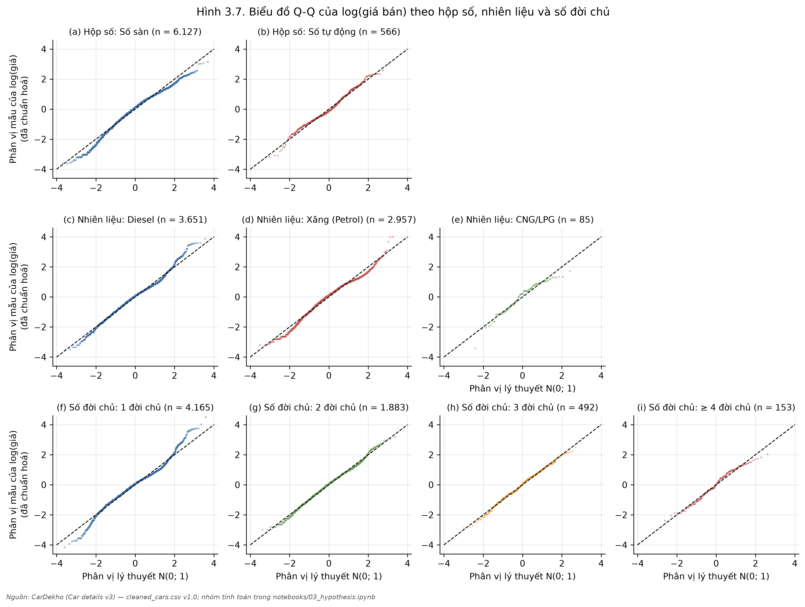
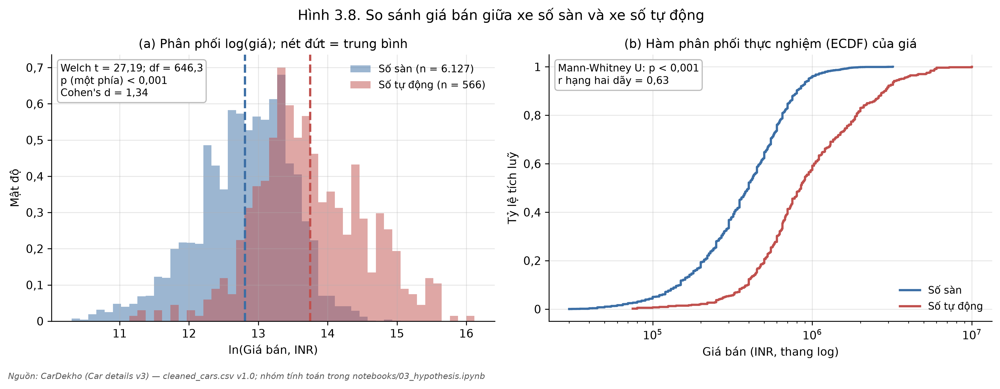
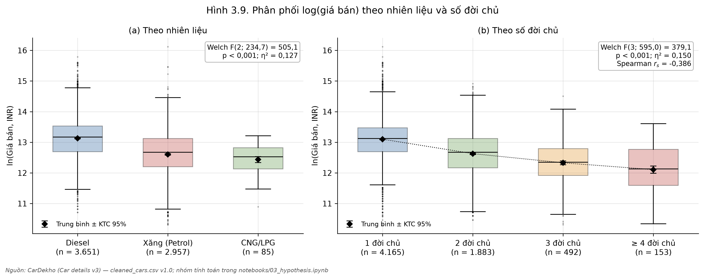
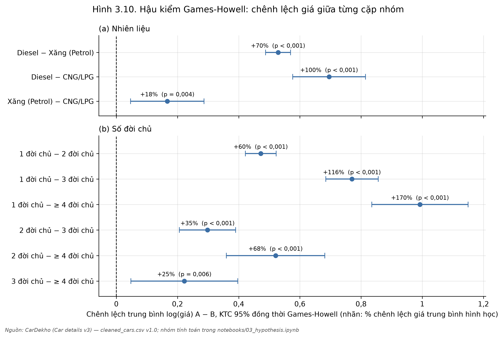
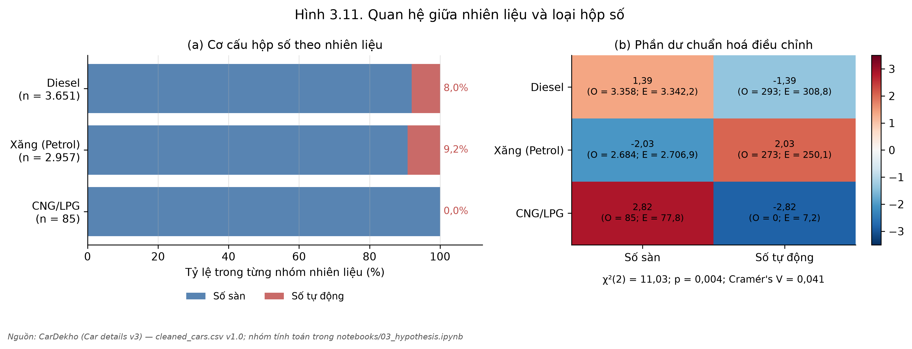

# CHƯƠNG 3. KẾT QUẢ PHÂN TÍCH

## 3.1. Thống kê mô tả và ước lượng

> *[Uyên (TV2) — nguồn: `notebooks/02_eda.ipynb`. Gợi ý cấu trúc: 3.1.1 Đặc trưng mẫu biến định lượng (Bảng 3.1);
> 3.1.2 Biến phân loại (Bảng 3.2, Hình 3.x); 3.1.3 Phân phối và tương quan; 3.1.4 Khoảng tin cậy 95% cho giá theo hộp số
> và nhiên liệu, KTC cho tỷ lệ xe số tự động. Ghi cỡ mẫu từng nhóm; lưu ý CNG = 50, LPG = 35.]*

## 3.2. Kiểm định giả thuyết

Mục này trả lời các câu hỏi CH2 – CH4 bằng kiểm định giả thuyết thống kê. Mọi con số dưới đây lấy từ
`notebooks/03_hypothesis.ipynb` (ô "7. Số liệu cho báo cáo"), chạy trên `cleaned_cars.csv` v1.0 ($n = 6.693$); bảng gốc dạng
`.csv` và hình 300 dpi nằm trong `figures/03_hypothesis/`. Các kiểm định được tính bằng SciPy (Virtanen và cộng sự, 2020)
và statsmodels (Seabold & Perktold, 2010); Welch ANOVA, Games-Howell và Dunn được cài trực tiếp trong notebook và đã đối chiếu
khớp với `pingouin` và `scikit-posthocs`.

### 3.2.1. Giả thuyết và quy trình kiểm định

Theo quy trình ở mục 2.5.1, giả thuyết của từng kiểm định được viết **trước khi chạy** (Bảng 3.5). Ký hiệu $\mu$ là trung bình
tổng thể của $\ln(\text{giá})$; vì $e^{\mu}$ là trung bình hình học của giá, so sánh $\mu$ tương đương so sánh mức giá "điển
hình" của từng nhóm mà không bị vài xe rất đắt chi phối. Chênh lệch $\Delta$ của $\ln(\text{giá})$ được quy đổi thành % chênh
lệch giá bằng $100\,(e^{\Delta}-1)\%$ (mục 2.5.7). Mức ý nghĩa $\alpha = 0{,}05$; năm kiểm định chính KĐ1 – KĐ5 tạo thành một
họ và được hiệu chỉnh Holm (mục 2.5.6).

: Bảng 3.5. Giả thuyết của các kiểm định ($\alpha = 0{,}05$; $\mu$ là trung bình của $\ln(\text{giá})$)

| KĐ | Câu hỏi | $H_0$ | $H_1$ | Kiểm định chính | Kiểm tra lại | Hệ số ảnh hưởng |
|---|---|---|---|---|---|---|
| KĐ1 | CH2 | $\mu_{\text{tự động}} = \mu_{\text{số sàn}}$ | $\mu_{\text{tự động}} > \mu_{\text{số sàn}}$ (một phía) | Welch t-test | Mann-Whitney U | Cohen's $d$; $r$ hạng hai dãy |
| KĐ2 | CH3 | $\mu_{\text{Diesel}} = \mu_{\text{Xăng}} = \mu_{\text{CNG/LPG}}$ | Ít nhất một cặp khác nhau | Welch ANOVA + Games-Howell | Kruskal-Wallis + Dunn (Holm) | $\eta^2$; $\varepsilon^2$ |
| KĐ3 | CH3 | $\mu$ bằng nhau ở 4 mức số đời chủ | Ít nhất một cặp khác nhau | Welch ANOVA + Games-Howell | Kruskal-Wallis + Dunn (Holm) | $\eta^2$; $\varepsilon^2$ |
| KĐ4 | CH3 | $\rho_s = 0$ giữa `owner_rank` và giá | $\rho_s \ne 0$ | Tương quan hạng Spearman | — | $r_s$ |
| KĐ5 | CH4 | Nhiên liệu và hộp số độc lập | Không độc lập | Chi-bình phương | Fisher (bảng 2×2) | Cramér's $V$ |

*Nguồn: Nhóm nghiên cứu.*

KĐ1 dùng $H_1$ một phía vì CH2 hỏi có hướng ("cao hơn"). Nhiên liệu dùng `fuel_group` (CNG và LPG gộp thành 85 xe) để tránh
nhóm quá nhỏ. Vì `owner` là biến thứ bậc, ngoài so sánh nhóm (KĐ3) nhóm kiểm định thêm xu hướng đơn điệu bằng Spearman (KĐ4).

### 3.2.2. Kiểm tra giả định

**Phân phối chuẩn.** Trên thang log, cả chín nhóm đều có độ lệch tuyệt đối không quá 0,77 và độ nhọn dư tuyệt đối không quá
1,58 (Bảng 3.6), thấp xa ngưỡng 2 và 7 mà Kim (2013) đề xuất cho mẫu lớn. Điểm trên biểu đồ Q-Q bám sát đường chéo ở phần thân,
chỉ lệch nhẹ ở hai đuôi (Hình 3.7). Shapiro-Wilk bác bỏ tính chuẩn ở 8/9 nhóm (trừ nhóm 3 đời chủ, $p = 0{,}189$) — điều được
dự báo trước ở mục 2.5.2 vì kiểm định có lực rất cao khi $n$ lớn; với nhóm số sàn ($n = 6.127 > 5.000$), p-value của
`scipy` không còn chính xác nên chỉ dùng tham khảo. Kết hợp với định lý giới hạn trung tâm (nhóm nhỏ nhất có 85 xe), giả định
chuẩn của trung bình mẫu được chấp nhận.

: Bảng 3.6. Kiểm tra giả định phân phối chuẩn của $\ln(\text{giá})$ theo từng nhóm

| Biến | Nhóm | $n$ | TB $\ln(\text{giá})$ | ĐLC | Độ lệch | Độ nhọn dư | Shapiro-Wilk $p$ |
|---|---|---:|---:|---:|---:|---:|---:|
| Hộp số | Số sàn | 6.127 | 12,809 | 0,691 | −0,54 | 0,33 | < 0,001 (tham khảo) |
| | Số tự động | 566 | 13,748 | 0,794 | 0,14 | 0,14 | < 0,001 |
| Nhiên liệu | Diesel | 3.651 | 13,131 | 0,690 | 0,03 | 0,87 | < 0,001 |
| | Xăng (Petrol) | 2.957 | 12,602 | 0,714 | −0,39 | 0,51 | < 0,001 |
| | CNG/LPG | 85 | 12,435 | 0,449 | −0,77 | 0,42 | 0,002 |
| Số đời chủ | 1 đời chủ | 4.165 | 13,100 | 0,670 | −0,02 | 1,58 | < 0,001 |
| | 2 đời chủ | 1.883 | 12,628 | 0,722 | −0,11 | 0,18 | < 0,001 |
| | 3 đời chủ | 492 | 12,330 | 0,701 | −0,14 | −0,05 | 0,189 |
| | ≥ 4 đời chủ | 153 | 12,108 | 0,739 | −0,20 | −0,86 | 0,009 |

*Nguồn: notebooks/03_hypothesis.ipynb (bang_3_6_gia_dinh_chuan.csv).*

{width=16cm}

**Đồng nhất phương sai.** Kiểm định Levene (dạng trung vị của Brown-Forsythe) bác bỏ $H_0$ "phương sai bằng nhau" ở cả ba biến
(Bảng 3.7). Đồng thời cỡ nhóm lệch rất mạnh: nhóm Diesel lớn gấp 43 lần nhóm CNG/LPG, nhóm số sàn gấp 10,8 lần nhóm số tự động.
Khi phương sai và cỡ nhóm cùng khác nhau, kiểm định Student và ANOVA cổ điển không giữ đúng mức sai lầm loại I, nên nhóm chọn
**Welch t-test** cho hai nhóm và **Welch ANOVA + Games-Howell** cho nhiều nhóm; Mann-Whitney U và Kruskal-Wallis + Dunn (Holm)
dùng để kiểm tra lại độ vững của kết luận.

: Bảng 3.7. Kiểm định Levene (Brown-Forsythe) về đồng nhất phương sai của $\ln(\text{giá})$

| Biến | Số nhóm | $W$ | df | $p$ | ĐLC lớn nhất / nhỏ nhất | Cỡ nhóm lớn nhất / nhỏ nhất | Kết luận |
|---|---:|---:|---:|---:|---:|---:|---|
| Hộp số | 2 | 18,16 | (1; 6.691) | < 0,001 | 1,15 | 10,8 | Bác bỏ $H_0$ → dùng Welch |
| Nhiên liệu | 3 | 10,90 | (2; 6.690) | < 0,001 | 1,59 | 43,0 | Bác bỏ $H_0$ → dùng Welch |
| Số đời chủ | 4 | 13,96 | (3; 6.689) | < 0,001 | 1,10 | 27,2 | Bác bỏ $H_0$ → dùng Welch |

*Nguồn: notebooks/03_hypothesis.ipynb (bang_3_7_levene.csv).*

### 3.2.3. Giá xe số tự động và số sàn (KĐ1)

Xe số tự động có giá trung bình hình học 934.796 INR (trung vị 850.000 INR, $n = 566$), so với 365.464 INR của xe số sàn
(trung vị 400.000 INR, $n = 6.127$). Welch t-test trên $\ln(\text{giá})$ cho $t = 27{,}19$, $df = 646{,}3$, $p < 0{,}001$
(một phía), nên **bác bỏ $H_0$**. Chênh lệch trung bình $\Delta = 0{,}939$ (KTC 95%: 0,871 – 1,007) nghĩa là giá điển hình
của xe số tự động **gấp 2,56 lần** xe số sàn (KTC 95%: 2,39 – 2,74 lần), tức cao hơn khoảng 156%. Hệ số Cohen's $d = 1{,}34$
thuộc mức **lớn**.

Kiểm định Mann-Whitney U cho cùng kết luận ($U = 2.829.186{,}5$; $p < 0{,}001$). Hệ số tương quan hạng hai dãy
$r = 2U/(n_1 n_2) - 1 = 0{,}63$ (Kerby, 2014) ở mức lớn: nếu
chọn ngẫu nhiên một xe mỗi loại, xác suất xe số tự động đắt hơn khoảng $(1 + 0{,}63)/2 \approx 82\%$. Hàm phân phối thực nghiệm
của xe số tự động nằm bên phải xe số sàn trên gần như toàn miền giá (Hình 3.8b): ở mọi phân vị, xe số tự động đều đắt hơn.

{width=16cm}

### 3.2.4. Giá theo nhiên liệu (KĐ2)

Giá trung bình hình học của xe Diesel là 504.230 INR, xe xăng 297.159 INR và xe CNG/LPG 251.532 INR. Welch ANOVA cho
$F(2;\ 234{,}7) = 505{,}1$, $p < 0{,}001$ — **bác bỏ $H_0$**; nhiên liệu giải thích $\eta^2 = 12{,}7\%$ biến thiên của
$\ln(\text{giá})$ (mức vừa, gần ngưỡng lớn). Kruskal-Wallis cho cùng kết luận ($H = 873{,}0$; $p < 0{,}001$;
$\varepsilon^2 = 0{,}130$) (Bảng 3.8).

Hậu kiểm Games-Howell (Bảng 3.9, Hình 3.10a) cho thấy **cả ba cặp đều khác nhau**: xe Diesel đắt hơn xe xăng khoảng 70%
($d = 0{,}75$) và đắt gấp khoảng 2 lần xe CNG/LPG ($d = 1{,}01$); xe xăng đắt hơn xe CNG/LPG khoảng 18% ($p = 0{,}004$), nhưng
hệ số ảnh hưởng chỉ ở mức nhỏ ($d = 0{,}24$) và khoảng tin cậy rộng (5% – 33%) do nhóm CNG/LPG chỉ có 85 xe. Dunn (Holm) xác
nhận cả ba cặp. Thứ tự giá **Diesel > xăng > CNG/LPG** trùng với thứ tự công suất động cơ của các nhóm trong mẫu (công suất
trung vị 88,7 bhp ở xe Diesel, 78,9 bhp ở xe xăng và 58,3 bhp ở xe CNG/LPG, Bảng 3.12): xe CNG/LPG trong mẫu chủ yếu là xe cỡ
nhỏ, công suất thấp.

### 3.2.5. Giá theo số đời chủ (KĐ3, KĐ4)

Giá trung bình hình học giảm dần theo số đời chủ: 489.166 INR (1 đời chủ), 305.104 INR (2 đời), 226.446 INR (3 đời) và
181.288 INR (từ 4 đời trở lên). Welch ANOVA cho $F(3;\ 595{,}0) = 379{,}1$, $p < 0{,}001$ — **bác bỏ $H_0$**; số đời chủ giải
thích $\eta^2 = 15{,}0\%$ biến thiên của $\ln(\text{giá})$ (mức **lớn**). Kruskal-Wallis cho cùng kết luận ($H = 1.006{,}8$;
$p < 0{,}001$; $\varepsilon^2 = 0{,}150$).

: Bảng 3.8. So sánh $\ln(\text{giá})$ theo nhiên liệu và số đời chủ

| Biến | Welch $F$ | df | $p$ | $F$ cổ điển (tham khảo) | $\eta^2$ | Kruskal-Wallis $H$ | $p$ | $\varepsilon^2$ |
|---|---:|---:|---:|---:|---:|---:|---:|---:|
| Nhiên liệu | 505,1 | (2; 234,7) | < 0,001 | 486,8 | 0,127 (vừa) | 873,0 | < 0,001 | 0,130 |
| Số đời chủ | 379,1 | (3; 595,0) | < 0,001 | 394,2 | 0,150 (lớn) | 1.006,8 | < 0,001 | 0,150 |

*Nguồn: notebooks/03_hypothesis.ipynb (bang_3_8_anova.csv).*

Games-Howell cho thấy **cả sáu cặp đều khác nhau** (Bảng 3.9, Hình 3.10b). Mỗi đời chủ thêm vào gắn với mức giá thấp hơn rõ rệt:
xe 1 đời chủ đắt hơn xe 2 đời chủ khoảng 60%, hơn xe 3 đời chủ khoảng 116% và hơn xe từ 4 đời chủ khoảng 170% ($d = 1{,}48$).
Chênh lệch nhỏ nhất là giữa 3 đời chủ và từ 4 đời chủ (khoảng 25%, $p = 0{,}006$; Dunn-Holm $p = 0{,}033$; $d = 0{,}31$).
Kiểm định xu hướng (KĐ4) bằng hệ số tương quan hạng Spearman (Spearman, 1904) cho $r_s = -0{,}386$, $p < 0{,}001$, nên bác bỏ
$H_0$: tương quan âm mức **vừa**, tức xe qua càng nhiều đời chủ thì
giá càng thấp (Hình 3.9b).

{width=16cm}

: Bảng 3.9. Hậu kiểm từng cặp: Games-Howell (chính) và Dunn hiệu chỉnh Holm (kiểm tra lại)

| Biến | Cặp (A − B) | $\Delta$ $\ln(\text{giá})$ | KTC 95% đồng thời | Chênh lệch giá | $p$ Games-Howell | $p$ Dunn (Holm) | Cohen's $d$ |
|---|---|---:|---:|---:|---:|---:|---:|
| Nhiên liệu | Diesel − Xăng | 0,529 | [0,488; 0,570] | +69,7% | < 0,001 | < 0,001 | 0,75 (vừa) |
| | Diesel − CNG/LPG | 0,695 | [0,576; 0,815] | +100,5% | < 0,001 | < 0,001 | 1,01 (lớn) |
| | Xăng − CNG/LPG | 0,167 | [0,047; 0,287] | +18,1% | 0,004 | 0,001 | 0,24 (nhỏ) |
| Số đời chủ | 1 − 2 đời chủ | 0,472 | [0,422; 0,522] | +60,3% | < 0,001 | < 0,001 | 0,69 (vừa) |
| | 1 − 3 đời chủ | 0,770 | [0,685; 0,856] | +116,0% | < 0,001 | < 0,001 | 1,14 (lớn) |
| | 1 − ≥ 4 đời chủ | 0,993 | [0,835; 1,150] | +169,8% | < 0,001 | < 0,001 | 1,48 (lớn) |
| | 2 − 3 đời chủ | 0,298 | [0,206; 0,390] | +34,7% | < 0,001 | < 0,001 | 0,42 (nhỏ) |
| | 2 − ≥ 4 đời chủ | 0,521 | [0,360; 0,681] | +68,3% | < 0,001 | < 0,001 | 0,72 (vừa) |
| | 3 − ≥ 4 đời chủ | 0,222 | [0,048; 0,397] | +24,9% | 0,006 | 0,033 | 0,31 (nhỏ) |

*Nguồn: notebooks/03_hypothesis.ipynb (bang_3_9_hau_kiem.csv). Chênh lệch giá $= 100\,(e^{\Delta}-1)\%$ theo trung bình hình học.*

{width=15cm}

### 3.2.6. Quan hệ giữa nhiên liệu và loại hộp số (KĐ5)

Bảng tiếp liên 3 × 2 (Bảng 3.10) có tần số kỳ vọng nhỏ nhất là 7,19 (ô CNG/LPG – số tự động), nên mọi ô đều thoả $E_{ij} \ge 5$
và kiểm định Chi-bình phương (Pearson, 1900) hợp lệ mà không cần dùng kiểm định chính xác Fisher (Fisher, 1922). Kết quả
$\chi^2(2) = 11{,}03$, $p = 0{,}004$ — **bác bỏ $H_0$**:
nhiên liệu và hộp số không hoàn toàn độc lập. Tuy nhiên Cramér's $V = 0{,}041$, thấp hơn ngưỡng 0,1, nên mức phụ thuộc **không
đáng kể về thực tế**.

: Bảng 3.10. Bảng tiếp liên nhiên liệu × hộp số: tần số quan sát $O$ và kỳ vọng $E$

| Nhiên liệu | Số sàn: $O$ ($E$) | Số tự động: $O$ ($E$) | Tổng | % số tự động | Phần dư chuẩn hoá điều chỉnh (số tự động) |
|---|---:|---:|---:|---:|---:|
| Diesel | 3.358 (3.342,2) | 293 (308,8) | 3.651 | 8,0% | −1,39 |
| Xăng (Petrol) | 2.684 (2.706,9) | 273 (250,1) | 2.957 | 9,2% | +2,03 |
| CNG/LPG | 85 (77,8) | 0 (7,2) | 85 | 0,0% | −2,82 |

*Nguồn: notebooks/03_hypothesis.ipynb (bang_3_10_bang_tiep_lien.csv).*

Phần dư chuẩn hoá điều chỉnh (Hình 3.11b) cho thấy sự phụ thuộc đến chủ yếu từ nhóm CNG/LPG **không có chiếc xe số tự động
nào** (phần dư −2,82), cùng với tỷ lệ số tự động hơi cao hơn ở xe xăng (+2,03). Khi bỏ nhóm CNG/LPG và chỉ so sánh Diesel với
xăng (bảng 2 × 2), tỷ lệ số tự động 8,0% và 9,2% không khác nhau có ý nghĩa ($\chi^2(1) = 3{,}04$, $p = 0{,}081$; Fisher
$p = 0{,}085$; $\varphi = 0{,}021$). Nói cách khác, ở hai loại nhiên liệu phổ biến, loại hộp số gần như không phụ thuộc vào
nhiên liệu; xe CNG/LPG là trường hợp riêng: đây là nhóm xe cỡ nhỏ, công suất thấp và trong mẫu chỉ có bản số sàn.

{width=16cm}

### 3.2.7. Tổng hợp và lưu ý khi diễn giải

Sau hiệu chỉnh Holm cho năm kiểm định chính, cả năm $H_0$ đều bị bác bỏ ở mức $\alpha = 0{,}05$ (Bảng 3.11). Tuy nhiên mức độ
ảnh hưởng rất khác nhau: hộp số có ảnh hưởng lớn nhất ($d = 1{,}34$), sau đó là số đời chủ ($\eta^2 = 0{,}150$) và nhiên liệu
($\eta^2 = 0{,}127$); còn quan hệ giữa nhiên liệu và hộp số có ý nghĩa thống kê nhưng không đáng kể về thực tế ($V = 0{,}041$).
Mọi kiểm định phi tham số đều cho cùng kết luận với kiểm định chính, nên kết quả không phụ thuộc vào giả định phân phối chuẩn.

: Bảng 3.11. Tổng hợp kết quả kiểm định giả thuyết ($\alpha = 0{,}05$; $p$ hiệu chỉnh Holm cho họ KĐ1 – KĐ5)

| KĐ | $H_0$ | Kiểm định (lý do chọn) | Thống kê | $p$ (Holm) | Hệ số ảnh hưởng | Kết luận thực tế |
|---|---|---|---|---:|---|---|
| KĐ1 | $\mu_{\text{tự động}} = \mu_{\text{số sàn}}$ | Welch t một phía (phương sai khác nhau, cỡ nhóm lệch) | $t = 27{,}19$; $df = 646{,}3$ | < 0,001 | $d = 1{,}34$ (lớn) | Xe số tự động đắt gấp 2,56 lần (KTC 95%: 2,39 – 2,74) |
| KĐ2 | $\mu$ bằng nhau theo nhiên liệu | Welch ANOVA + Games-Howell (CNG/LPG chỉ 85 xe) | $F(2;\ 234{,}7) = 505{,}1$ | < 0,001 | $\eta^2 = 0{,}127$ (vừa) | Diesel > xăng > CNG/LPG; cả 3 cặp khác nhau |
| KĐ3 | $\mu$ bằng nhau theo số đời chủ | Welch ANOVA + Games-Howell (cỡ nhóm 153 – 4.165) | $F(3;\ 595{,}0) = 379{,}1$ | < 0,001 | $\eta^2 = 0{,}150$ (lớn) | Cả 6 cặp khác nhau |
| KĐ4 | $\rho_s = 0$ | Spearman (`owner` là biến thứ bậc) | $r_s = -0{,}386$; $n = 6.693$ | < 0,001 | $r_s = -0{,}386$ (vừa) | Giá giảm dần từ 489.166 INR (1 đời) xuống 181.288 INR (≥ 4 đời) |
| KĐ5 | Nhiên liệu và hộp số độc lập | Chi-bình phương (mọi $E_{ij} \ge 5$) | $\chi^2(2) = 11{,}03$ | 0,004 | $V = 0{,}041$ (không đáng kể) | Phụ thuộc rất yếu, do CNG/LPG không có xe số tự động |

*Nguồn: notebooks/03_hypothesis.ipynb (bang_3_11_tong_hop.csv).*

**Yếu tố gây nhiễu.** Như đã nêu ở mục 2.5.8, các kiểm định trên chỉ cho thấy giữa các nhóm **có khác biệt**, chưa tách được
tác động riêng của từng yếu tố. Bảng 3.12 cho thấy các nhóm còn khác nhau rõ ở những biến cũng ảnh hưởng mạnh tới giá: xe số tự
động trẻ hơn 2 năm, chạy ít hơn và có công suất trung vị cao hơn khoảng 54% so với xe số sàn; xe nhiều đời chủ thì cũ hơn
(tuổi trung bình tăng từ 5,0 lên 11,7 năm; hệ số Spearman giữa `owner_rank` và `car_age` là 0,502) và chạy nhiều hơn. Vì
vậy chênh lệch 2,56 lần giữa hai loại hộp số hay 170% giữa xe 1 đời chủ và từ 4 đời chủ **gộp cả** ảnh hưởng của tuổi xe, công
suất và hãng xe. Tác động riêng của hộp số, nhiên liệu và số đời chủ khi giữ các yếu tố khác không đổi được ước lượng bằng mô
hình hồi quy bội ở mục 3.3.

: Bảng 3.12. Đặc điểm các nhóm có thể gây nhiễu kết quả kiểm định

| Biến | Nhóm | $n$ | Tuổi xe TB (năm) | `km_driven` trung vị | `max_power` trung vị (bhp) | % số tự động |
|---|---|---:|---:|---:|---:|---:|
| Hộp số | Số sàn | 6.127 | 6,6 | 70.000 | 81,8 | — |
| | Số tự động | 566 | 4,6 | 42.000 | 126,2 | — |
| Nhiên liệu | Diesel | 3.651 | 6,2 | 80.000 | 88,7 | 8,0 |
| | Xăng (Petrol) | 2.957 | 6,6 | 49.455 | 78,9 | 9,2 |
| | CNG/LPG | 85 | 6,6 | 70.000 | 58,3 | 0,0 |
| Số đời chủ | 1 đời chủ | 4.165 | 5,0 | 50.000 | 82,0 | 10,3 |
| | 2 đời chủ | 1.883 | 8,2 | 80.000 | 78,0 | 5,9 |
| | 3 đời chủ | 492 | 10,0 | 97.000 | 75,0 | 3,7 |
| | ≥ 4 đời chủ | 153 | 11,7 | 100.000 | 78,9 | 3,3 |

*Nguồn: notebooks/03_hypothesis.ipynb (bang_3_12_gay_nhieu.csv).*

Ngoài ra, giá trong dữ liệu là giá **rao bán** và số đời chủ do người bán tự khai báo, nên các kết luận trên mô tả mặt bằng giá
rao trên CarDekho.com, không phải giá giao dịch thực tế.

## 3.3. Mô hình hồi quy tuyến tính bội

> *[Nguyên (TV4) — nguồn: `notebooks/04_regression.ipynb`. Phương trình hồi quy, bảng hệ số (diễn giải theo %), R², Adj R²,
> VIF, so sánh mô hình đầy đủ và stepwise, 4 đồ thị chẩn đoán, Breusch-Pagan/HC3, Cook's distance, RMSE/MAE trên tập test.]*
